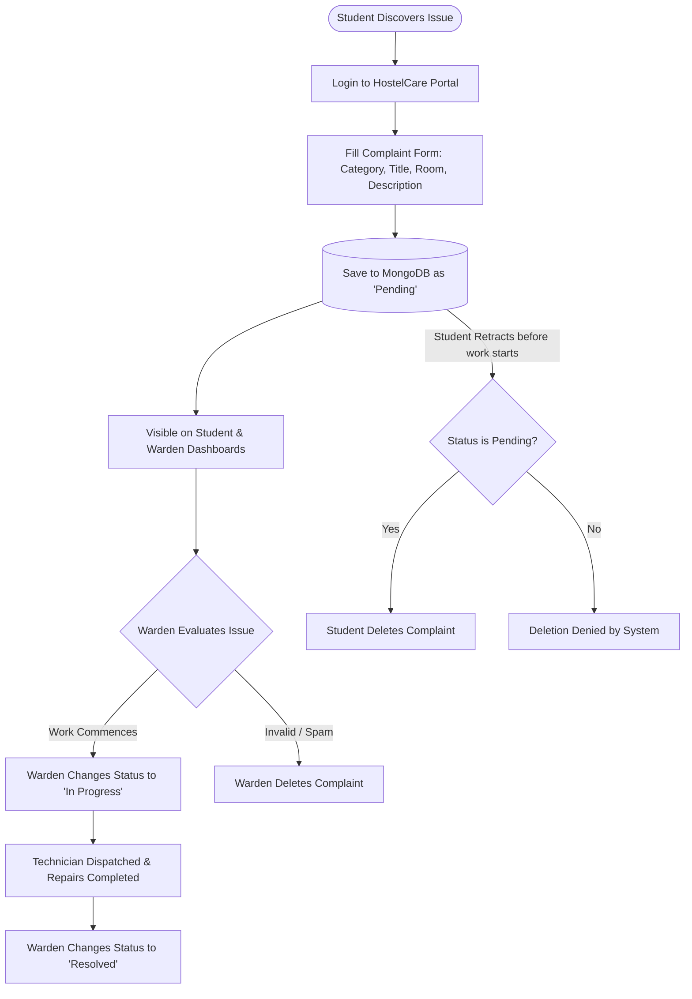
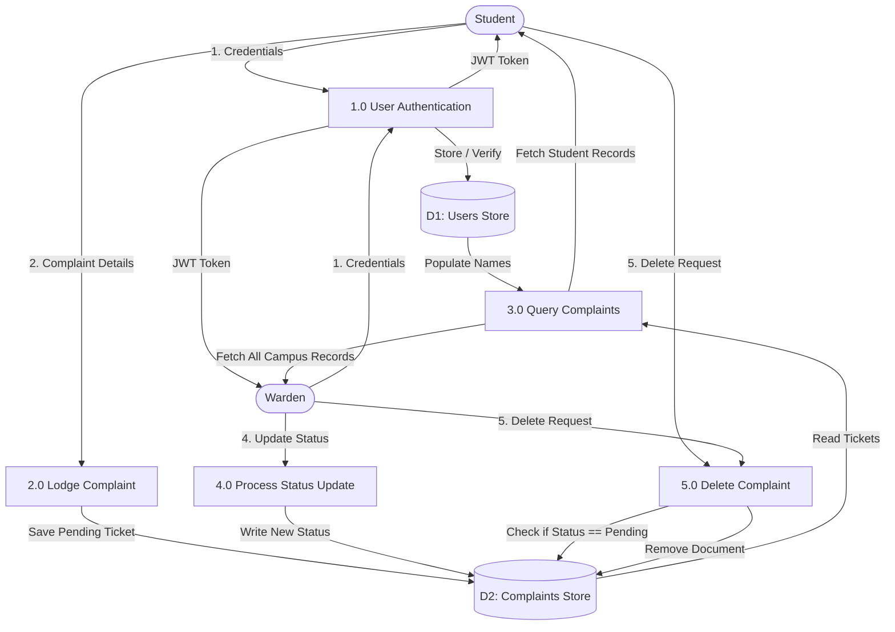
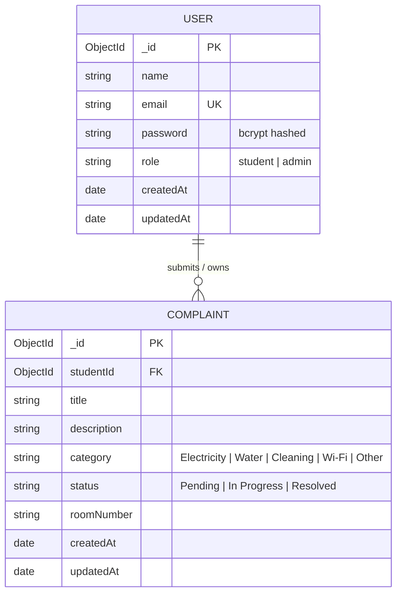
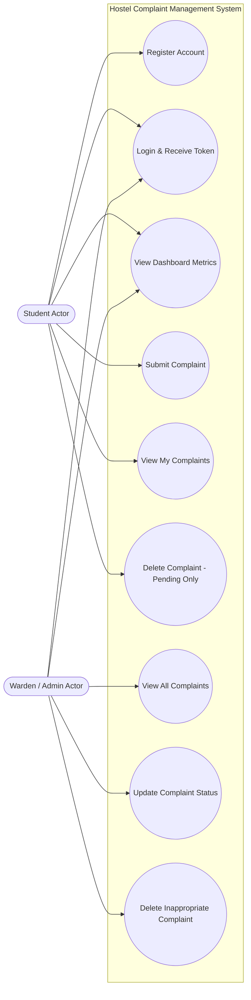
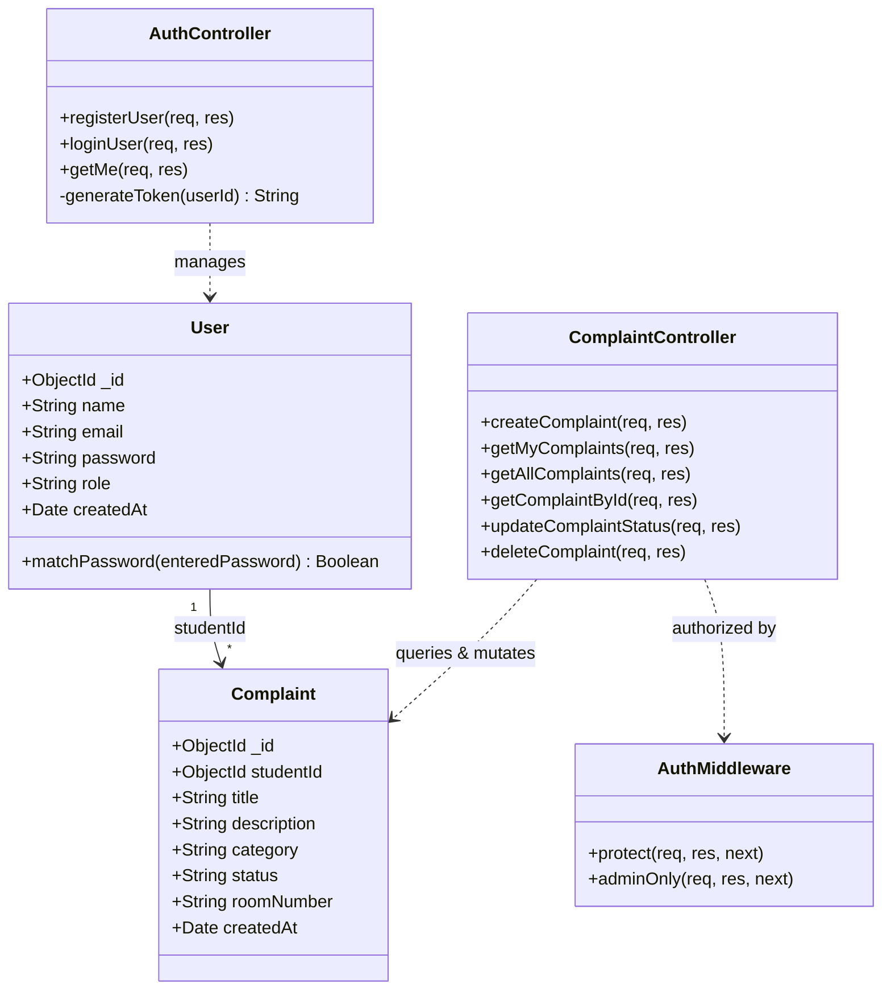
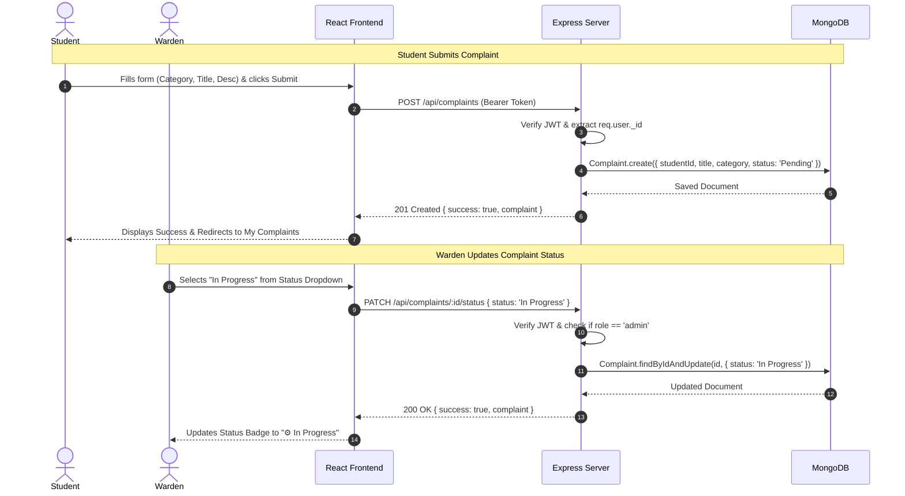
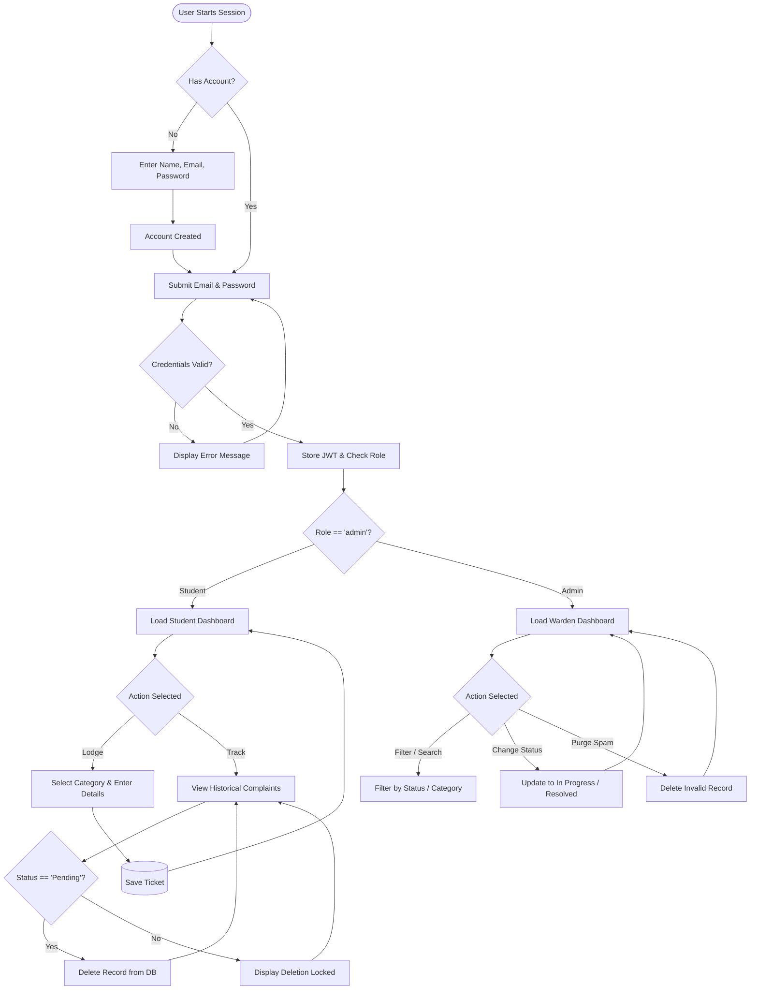
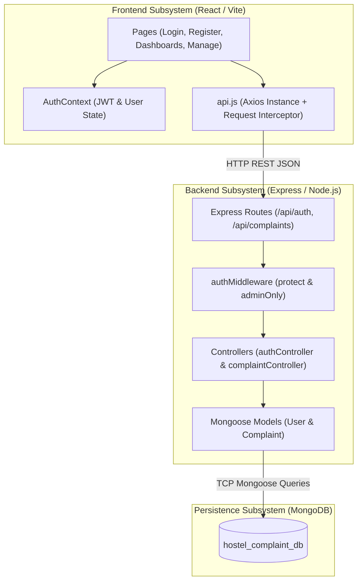

# PROJECT REPORT

**ON**

# HOSTEL COMPLAINT MANAGEMENT SYSTEM

*A Modern Web-Based Grievance Redressal and Maintenance Tracking Platform Using the MERN Stack*

---

**Submitted in partial fulfillment of the requirements for the degree of**  
**Bachelor of Technology / Master of Computer Applications**

---

## RECOMMENDATION

This is to certify that the project report entitled **"Hostel Complaint Management System"**, submitted by **Abdul Rehman Gori**, in partial fulfillment of the requirements for the award of the Degree, is a bonafide record of the work carried out under my supervision and guidance. 

The project embodies original work and satisfies the technical and academic standards prescribed by the department.

\
**Project Guide / Supervisor:**  
_____________________________  
Department of Computer Science & Engineering / Computer Applications  

Date: 12th October 2026  
Place: Indore, Madhya Pradesh  

---

## CERTIFICATE

This is to certify that the project report entitled **"Hostel Complaint Management System"**, submitted by **Abdul Rehman Gori**, has been successfully developed, evaluated, and approved by the Internal and External Examiners.

The candidate has fulfilled all academic and practical requirements as per the curriculum regulations.

\
**Head of the Department (HOD):**  
_____________________________  
Department of Computer Science & Engineering  

\
**Internal Examiner:** _____________________________  
**External Examiner:** _____________________________  

Date: 12th October 2026  
Seal of the Institute  

---

## DECLARATION

I hereby declare that the project report titled **"Hostel Complaint Management System"** is an authentic piece of work carried out by me under the guidance and mentorship of my project supervisor.

I further declare that this report has not been submitted previously, in part or in full, to any other University or Institution for the award of any degree, diploma, or fellowship. All sources of literature, reference libraries, and software frameworks utilized have been duly acknowledged.

\
**Abdul Rehman Gori**  
Department of Computer Science & Engineering / Computer Applications  

---

## ACKNOWLEDGEMENT

I express my deepest gratitude to my project supervisor for continuous encouragement, valuable suggestions, and constructive technical feedback throughout the development of the **Hostel Complaint Management System**.

I extend my sincere thanks to the Head of the Department and all faculty members for providing the requisite laboratory infrastructure, technical resources, and intellectual environment that made this project possible.

Finally, I would like to thank my peers, friends, and family for their unwavering support, moral encouragement, and cooperation throughout the lifecycle of this project.

**Abdul Rehman Gori**

---

## ABSTRACT

The administration of modern educational and residential institutions involves managing hundreds of residential students living in hostel facilities. Efficient maintenance operations—including electrical, plumbing, sanitation, and internet infrastructure—are fundamental to student welfare. Traditional grievance redressal methods relying on manual paper registers, verbal complaints to wardens, or uncoordinated messaging groups are plagued by inefficiencies: grievances are frequently misplaced, resolution progress is opaque, duplicate entries cannot be cross-checked, and management lacks actionable audit records.

This project, titled **"Hostel Complaint Management System"**, addresses these operational bottlenecks by introducing a centralized, role-based web application developed using the **MERN Stack** (MongoDB, Express.js, React.js with Vite, and Node.js). 

The system provides dedicated portals for two primary stakeholders: **Students** and the **Hostel Warden / Administrator**. Students can register, securely authenticate using JSON Web Tokens (JWT), lodge categorized complaints (Electricity, Water, Cleaning, Wi-Fi, or Other), monitor live status progression (`Pending`, `In Progress`, `Resolved`), view dashboard metrics, and delete complaints strictly while their status remains `Pending`. Hostel Wardens have an administrative dashboard summarizing campus-wide complaints, department breakdowns, and comprehensive student information, alongside privileges to update issue statuses and eliminate invalid tickets. 

Experimental testing demonstrates that the centralized system eliminates lost records, enforces strict access control through bcrypt password hashing and JWT authorization, and accelerates maintenance turnaround times through streamlined workflows.

---

## TABLE OF CONTENTS

| Section / Chapter | Title | Page No. |
|---|---|---|
| | **RECOMMENDATION** | 2 |
| | **CERTIFICATE** | 3 |
| | **DECLARATION** | 4 |
| | **ACKNOWLEDGEMENT** | 5 |
| | **ABSTRACT** | 6 |
| | **TABLE OF CONTENTS** | 7 |
| | **LIST OF FIGURES** | 9 |
| | **LIST OF TABLES** | 10 |
| | **LIST OF ABBREVIATIONS** | 11 |
| **Chapter 1** | **INTRODUCTION** | 12 |
| 1.1 | Overview | 12 |
| 1.2 | Objectives | 12 |
| 1.3 | Need of the Project | 12 |
| 1.4 | Problem Statement | 13 |
| 1.5 | Proposed Approach | 13 |
| 1.6 | Organisation of the Report | 13 |
| **Chapter 2** | **LITERATURE REVIEW** | 14 |
| 2.1 | Existing System | 14 |
| 2.2 | Limitations of Existing System | 14 |
| 2.3 | Advantages of Proposed Solution | 15 |
| 2.4 | Comparison of Existing Platforms | 15 |
| 2.5 | Research Gap | 15 |
| **Chapter 3** | **CASE STUDY / DATA COLLECTION** | 16 |
| 3.1 | System Workflow | 16 |
| 3.2 | User Roles | 16 |
| 3.3 | Requirements Gathering | 16 |
| 3.3.1 | Functional Requirements | 16 |
| 3.3.2 | Non-Functional Requirements | 17 |
| 3.4 | Real World Application | 18 |
| **Chapter 4** | **ANALYSIS AND DESIGN** | 19 |
| 4.1 | System Architecture | 19 |
| 4.2 | Database Design | 20 |
| 4.2.1 | Technology Stack | 20 |
| 4.2.2 | USER Collection | 21 |
| 4.2.3 | COMPLAINT Collection | 21 |
| 4.2.4 | Schema Relationships & Rules | 22 |
| 4.2.5 | Database Indexes | 22 |
| 4.3 | Data Flow Diagram (DFD) — Level 0 | 23 |
| 4.4 | Data Flow Diagram (DFD) — Level 1 | 23 |
| 4.5 | Entity-Relationship (ER) Diagram | 24 |
| 4.6 | Use Case Diagram | 25 |
| 4.7 | Class Diagram | 26 |
| 4.8 | Sequence Diagram | 27 |
| 4.9 | Activity Diagram | 28 |
| 4.10 | Deployment Diagram | 29 |
| 4.11 | Component Diagram | 29 |
| **Chapter 5** | **IMPLEMENTATION AND TESTING** | 30 |
| 5.1 | Implementation | 30 |
| 5.1.1 | Frontend Development | 30 |
| 5.1.2 | Backend Architecture | 30 |
| 5.1.3 | Authentication Module | 31 |
| 5.1.4 | Complaint Lifecycle & Status Engine | 31 |
| 5.1.5 | Key Algorithms | 32 |
| 5.2 | Testing | 34 |
| 5.2.1 | Unit Testing | 34 |
| 5.2.2 | Integration Testing | 34 |
| 5.2.3 | System Testing | 34 |
| **Chapter 6** | **RESULT** | 36 |
| 6.1 | System Testing Overview | 36 |
| 6.2 | Security Features and Verification | 36 |
| 6.3 | Known Limitations | 37 |
| **Chapter 7** | **CONCLUSION** | 38 |
| 7.1 | Achievements | 38 |
| 7.2 | Limitations | 38 |
| 7.3 | Future Work | 38 |
| | **REFERENCES** | 39 |
| | **APPENDIX: Application Screenshots** | 40 |

---

## LIST OF FIGURES

| Figure No. | Caption | Page No. |
|---|---|---|
| Figure 3.1 | End-to-End System Workflow | 16 |
| Figure 4.1 | Three-Tier System Architecture | 19 |
| Figure 4.2 | Data Flow Diagram (DFD) — Level 0 (Context Level) | 23 |
| Figure 4.3 | Data Flow Diagram (DFD) — Level 1 | 23 |
| Figure 4.4 | Entity-Relationship (ER) Diagram | 24 |
| Figure 4.5 | UML Use Case Diagram | 25 |
| Figure 4.6 | UML Class Diagram | 26 |
| Figure 4.7 | UML Sequence Diagram (Filing & Updating Complaints) | 27 |
| Figure 4.8 | UML Activity Diagram | 28 |
| Figure 4.9 | UML Deployment Diagram | 29 |
| Figure 4.10 | UML Component Diagram | 29 |
| Figure A.1 | User Sign In & Demo Authentication Screen | 40 |
| Figure A.2 | Student Dashboard with Metrics Overview | 40 |
| Figure A.3 | Lodge Complaint Submission Interface | 41 |
| Figure A.4 | Student Complaints Tracking & Filter View | 41 |
| Figure A.5 | Warden Administrative Management Portal | 42 |
| Figure A.6 | Complaint Detail Inspection Modal | 42 |

---

## LIST OF TABLES

| Table No. | Caption | Page No. |
|---|---|---|
| Table 2.1 | Comparison of Existing Platforms vs Proposed System | 15 |
| Table 3.1 | Functional Requirements Specification Matrix | 17 |
| Table 3.2 | Non-Functional Requirements Specification | 17 |
| Table 4.1 | Technology Stack Breakdown | 20 |
| Table 4.2 | User Collection Schema Definition | 21 |
| Table 4.3 | Complaint Collection Schema Definition | 21 |
| Table 4.4 | MongoDB Database Indexes | 22 |
| Table 5.1 | REST API Endpoint Verification Matrix | 33 |
| Table 5.2 | Comprehensive System Test Cases & Results | 35 |

---

## LIST OF ABBREVIATIONS

| Abbreviation | Full Form |
|---|---|
| **API** | Application Programming Interface |
| **Bcrypt** | Blowfish Cryptographic Hash Function |
| **CRUD** | Create, Read, Update, Delete |
| **CSS** | Cascading Style Sheets |
| **DFD** | Data Flow Diagram |
| **DOM** | Document Object Model |
| **ERD** | Entity-Relationship Diagram |
| **FIFO** | First In, First Out |
| **GUI** | Graphical User Interface |
| **HTTP / HTTPS** | Hypertext Transfer Protocol / Secure |
| **JSON** | JavaScript Object Notation |
| **JWT** | JSON Web Token |
| **MERN** | MongoDB, Express.js, React.js, Node.js |
| **MVC** | Model-View-Controller |
| **NoSQL** | Not Only Structured Query Language |
| **ODM** | Object Data Modeling |
| **REST** | Representational State Transfer |
| **SPA** | Single Page Application |
| **UI / UX** | User Interface / User Experience |
| **UML** | Unified Modeling Language |
| **URI** | Uniform Resource Identifier |

---

# Chapter 1: INTRODUCTION

## 1.1 Overview
Residential student hostels are integral components of university ecosystems. Within these residential complexes, routine facility maintenance—such as fixing water leakages, repairing electrical appliances, cleaning sanitary blocks, and restoring Wi-Fi connectivity—is crucial for ensuring conducive living and academic environments. 

The **Hostel Complaint Management System** is a responsive web application engineered to digitize, organize, and expedite the entire lifecycle of student maintenance complaints. Built upon the **MERN** technology stack (MongoDB, Express.js, React.js, and Node.js), the software provides an intuitive platform where residential students can lodge grievances in real-time, monitor progress across verified states, and interact transparently with hostel administration.

## 1.2 Objectives
The primary objectives of this project are:
1. **Automate Complaint Logging**: Provide students with an accessible, 24/7 web-based portal to record complaints under well-defined categories (`Electricity`, `Water`, `Cleaning`, `Wi-Fi`, `Other`).
2. **Transparent Status Tracking**: Provide immediate visibility into whether a maintenance request is `Pending`, `In Progress`, or `Resolved`.
3. **Role-Based Governance**: Protect sensitive administrative tools and ensure students cannot view, modify, or tamper with grievances belonging to other hostel residents.
4. **Conditional Student Deletion**: Enforce the business rule allowing students to cancel/delete a complaint **strictly while its status is Pending**, safeguarding records once maintenance staff begins work.
5. **Warden Management Dashboard**: Furnish the hostel warden with operational intelligence, aggregate metrics, quick search/filter tools, and full status adjustment capabilities.

## 1.3 Need of the Project
In conventional hostel environments, the lack of an organized logging tool causes severe operational friction:
- **Misplacement of Logs**: Handwritten physical registers kept at the security gate or warden desk frequently experience missing pages or illegible entries.
- **Lack of Accountability**: Without a verifiable timestamp and digital status, disputes arise between maintenance workers and students regarding when an issue was reported and why delays occurred.
- **Inability to Prioritize**: Wardens cannot readily ascertain which department has an accumulated backlog (e.g., whether electrical issues exceed plumbing complaints) without manually tallying paper entries.
- **Student Frustration**: Residents must repeatedly make in-person visits to the warden's office to inquire about basic maintenance updates.

## 1.4 Problem Statement
*"To design and implement a secure, beginner-friendly, and functional Hostel Complaint Management System using MongoDB, Express.js, React.js, and Node.js that enables students to report and track maintenance grievances while empowering hostel administrators to monitor, manage, and update complaints through real-time role-protected interfaces."*

## 1.5 Proposed Approach
The proposed solution implements a **Single Page Application (SPA)** architecture using **React.js** coupled with a high-performance **Express/Node.js REST API** and a **MongoDB** document database:
- **Presentation Tier**: Built using React 18 and Vite with vanilla CSS, maintaining a white background, slate typography, and vibrant blue accents. Sidebar navigation and responsive layout patterns allow usage on both desktop computers and mobile phones.
- **Logic Tier**: Developed using Express.js middleware pipelines. JSON Web Tokens (JWT) are signed upon login and transmitted via HTTP headers for stateless session verification.
- **Persistence Tier**: MongoDB documents structured using Mongoose ODM, enforcing validation rules, referential integrity between users and complaints, and timestamp generation.

## 1.6 Organisation of the Report
The remainder of this report is organized as follows:
- **Chapter 2** provides a literature review of existing manual and semi-digital platforms, highlighting current limitations and the research gap.
- **Chapter 3** presents the case study, user roles, and functional/non-functional requirements.
- **Chapter 4** describes the architectural models, database schemas, and UML diagrams (DFD, ER, Use Case, Class, Sequence, Activity, Deployment, Component).
- **Chapter 5** details implementation specifics, frontend/backend modules, key algorithms, and testing strategies.
- **Chapter 6** analyzes system testing results, verification metrics, and security features.
- **Chapter 7** concludes the report with a summary of achievements, limitations, and future enhancements.

---

# Chapter 2: LITERATURE REVIEW

## 2.1 Existing System
Hostel management operations across the majority of academic campuses currently employ one of the following approaches:
1. **Physical Register System**: A ledger kept at the hostel entrance or reception desk. Students physically write their room number, contact information, and description of the complaint.
2. **Ad-Hoc Messaging Groups**: Messaging channels (WhatsApp/Telegram) where students broadcast issues directly to hostel staff or student committees.
3. **Generic Online Forms**: Google Forms or shared spreadsheets managed periodically by office clerks.

## 2.2 Limitations of Existing System
Critical shortcomings identified across existing approaches include:
- **Physical Loss & Damage**: Register books are prone to physical wear, water damage, or accidental destruction.
- **Privacy Breaches**: Any resident flipping through a physical ledger can view other residents' personal names, room numbers, and phone numbers.
- **Zero Real-Time Tracking**: Students receive no notification or feedback indicating when a technician has been assigned or when parts have been ordered.
- **Unstructured Data in Messaging Groups**: Complaints sent via WhatsApp chats quickly get buried under extraneous conversation, leading to high omission rates.
- **Lack of Role-Based Constraints**: Shared Google Spreadsheets permit students to inadvertently overwrite or delete rows created by other residents.

## 2.3 Advantages of Proposed Solution
The proposed MERN-based platform delivers significant advantages:
1. **Strict Data Confidentiality**: Each student can only view their own submitted grievances.
2. **Atomic Status Updates**: Wardens can update status states (`Pending` ➔ `In Progress` ➔ `Resolved`), instantly reflecting across student dashboards.
3. **Automated Metrics Calculation**: The student and admin dashboards dynamically compute pending vs. resolved tallies directly from the database without manual computation.
4. **Conditional Protection Mechanism**: A student can retract a grievance only if work has not yet commenced (`Pending`). Once marked `In Progress`, the record is locked from student deletion.
5. **Zero Licensing Costs**: Built entirely on modern open-source software packages.

## 2.4 Comparison of Existing Platforms

| Parameter | Physical Ledger | WhatsApp / Messaging | Google Forms | Proposed MERN Portal |
|---|---|---|---|---|
| **Digital Accessibility** | No (Desk visit required) | Partial (Mobile app) | Yes (Web link) | **Yes (Responsive Web)** |
| **Role-Based Access** | None | None | None / Weak | **Strict (JWT & bcrypt)** |
| **Categorization** | Manual / Arbitrary | None | Partial | **Enforced Enums (5 Categories)** |
| **Live Status Tracking** | None | Verbal | None | **Live (`Pending`/`Progress`/`Resolved`)** |
| **Data Protection** | None | Exposed to all | Exposed to editors | **High (User-isolated queries)** |
| **Statistical Analytics** | Manual tallying | Impossible | Basic charts | **Automated Dashboard Metrics** |
| **Accidental Deletion Risk**| High (torn pages) | Moderate | High (Sheet edits)| **Protected (Role-restricted API)** |

*Table 2.1: Comparison of Existing Platforms vs Proposed System*

## 2.5 Research Gap
While commercial Enterprise Resource Planning (ERP) software exists for campus management, such commercial systems are notoriously complex, resource-heavy, expensive, and bloated with unnecessary modules (fee processing, biometric integration, payroll). Smaller institutions and independent student hostels require a focused, lightweight, beginner-friendly system dedicated solely to hostel grievance lifecycle management that can be self-hosted with minimal infrastructure overhead.

---

# Chapter 3: CASE STUDY / DATA COLLECTION

## 3.1 System Workflow
The operational workflow of the Hostel Complaint Management System follows an orderly lifecycle:



*Figure 3.1: End-to-End System Workflow*

## 3.2 User Roles
The system accommodates two distinct user roles:

1. **Student (`role: 'student'`)**:
   - Register a personal profile using full name, email, and password.
   - Securely sign in to receive an authorization token.
   - Lodge maintenance complaints specifying Category, Title, Description, and Room Number.
   - Review personal historical complaints.
   - Delete a complaint *only* while its status is `Pending`.
   - View aggregated metrics on the Student Dashboard.

2. **Hostel Warden / Administrator (`role: 'admin'`)**:
   - Access the Warden Management Portal with administrative credentials.
   - View comprehensive complaints submitted by all residents, including resident name, email, and room number.
   - Filter and search tickets across categories and progress statuses.
   - Inspect individual complaint descriptions in a dedicated modal.
   - Alter ticket status to `Pending`, `In Progress`, or `Resolved`.
   - Delete inappropriate, spam, or duplicate complaint entries.

## 3.3 Requirements Gathering

### 3.3.1 Functional Requirements
Functional requirements define the core operational behaviors of the application:

| Req ID | Module | Description | Authorized Role |
|---|---|---|---|
| **FR-01** | Authentication | Student account registration with password validation | Public |
| **FR-02** | Authentication | User login with bcrypt password matching & JWT issuance | Public |
| **FR-03** | Dashboard | Display counts: Total, Pending, In Progress, Resolved | Student / Admin |
| **FR-04** | Complaints | Submit complaint with valid category enum and details | Student |
| **FR-05** | Complaints | Retrieve personal complaint history | Student |
| **FR-06** | Complaints | Retrieve all campus complaints with student details | Admin |
| **FR-07** | Complaints | Inspect individual complaint detail | Owner Student / Admin |
| **FR-08** | Complaints | Update complaint status (`Pending`, `In Progress`, `Resolved`) | Admin |
| **FR-09** | Complaints | Delete complaint (Allowed strictly when status is `Pending`) | Student (Owner) |
| **FR-10** | Complaints | Delete any invalid/inappropriate complaint ticket | Admin |

*Table 3.1: Functional Requirements Specification Matrix*

### 3.3.2 Non-Functional Requirements

| Category | Requirement Specification |
|---|---|
| **Security** | Passwords must be hashed using `bcryptjs` with salt rounds >= 10. Passwords must never be stored in plaintext or exposed in API response payloads. JWT tokens must be verified on all private endpoints. |
| **Performance** | API responses must execute within < 100 milliseconds for standard read/write operations under local MongoDB query execution. |
| **Reliability** | Database connection pooling must recover gracefully from brief network disconnects without terminating the Node.js process. |
| **Usability** | The user interface must employ a responsive layout supporting screen widths from 360px (mobile) to 1920px (desktop), featuring status badges and accessible forms. |
| **Maintainability** | Frontend and backend code must strictly follow separation of concerns (MVC architecture and componentized React files). |

*Table 3.2: Non-Functional Requirements Specification*

## 3.4 Real World Application
The application is specifically tailored for:
- University On-Campus Hostels (Boys and Girls Wings).
- Private Student Hostels and Paying Guest (PG) Accommodations.
- Residential Boarding Schools and College Quarters.
- Corporate Staff Residential Dormitories.

---

# Chapter 4: ANALYSIS AND DESIGN

## 4.1 System Architecture
The software adheres to a standard **Three-Tier Architecture**:
1. **Presentation Tier (Client)**: A React.js Single Page Application served via Vite. Handles client-side routing, DOM manipulation, responsive UI layouts, and local state management.
2. **Application Tier (Server)**: A Node.js and Express.js REST API server. Handles routing, authentication verification, business rules (e.g. pending-only deletion validation), and data formatting.
3. **Data Tier (Database)**: A MongoDB NoSQL document database. Stores `users` and `complaints` collections with referential links.

```
+-----------------------------------------------------------------------+
|                       PRESENTATION TIER (REACT SPA)                   |
|  [Login / Register]   [Student Dashboard]    [Warden Management]      |
|           |                   |                      |                |
|      Axios Client with JWT Bearer Token Request Interceptors          |
+-----------------------------------------------------------------------+
                                   |  HTTP / JSON REST API
                                   v
+-----------------------------------------------------------------------+
|                    APPLICATION TIER (NODE.JS + EXPRESS)               |
|  [CORS / JSON Parser] -> [authMiddleware (JWT)] -> [Controllers]      |
|                                |                      |               |
|                        authController          complaintController    |
+-----------------------------------------------------------------------+
                                   |  Mongoose ODM Queries
                                   v
+-----------------------------------------------------------------------+
|                         DATA TIER (MONGODB NOSQL)                     |
|           [Users Collection]   <======>   [Complaints Collection]     |
|          (name, email, pass, role)       (title, desc, status, ref)   |
+-----------------------------------------------------------------------+
```

*Figure 4.1: Three-Tier System Architecture*

## 4.2 Database Design

### 4.2.1 Technology Stack
The technology stack employed across the project layers is detailed below:

| Layer | Technology | Version | Purpose |
|---|---|---|---|
| **Runtime** | Node.js | v22.x | Asynchronous JavaScript runtime environment |
| **Web Server** | Express.js | v4.21.x | REST API routing and middleware framework |
| **Database** | MongoDB | v7.x / v8.x | Document-oriented NoSQL persistence store |
| **ODM** | Mongoose | v8.9.x | Schema modeling, validation, and database operations |
| **Security** | bcryptjs & jsonwebtoken | ^2.4 / ^9.0 | Password salting/hashing and signed token creation |
| **Client Core**| React.js | v18.x | Declarative component-based UI framework |
| **Build Tool** | Vite | v8.3.x | Ultra-fast frontend bundling and hot module replacement |
| **Routing** | React Router DOM | v7.x | Declarative client-side SPA routing |
| **HTTP Client**| Axios | ^1.7.x | Promise-based asynchronous HTTP request client |

*Table 4.1: Technology Stack Breakdown*

### 4.2.2 USER Collection
The `User` collection records credentials and roles for students and hostel wardens.

| Field Name | Data Type | Constraints | Description |
|---|---|---|---|
| `_id` | ObjectId | Primary Key, Auto-generated | Unique identifier for the user document |
| `name` | String | Required, Trimmed | Full name of the student or administrator |
| `email` | String | Required, Unique, Lowercase, Trimmed | Official email address used for login |
| `password` | String | Required, Min length: 6 | Bcrypt hashed representation of user password |
| `role` | String | Enum: `['student', 'admin']`, Default: `'student'` | Authorization role within the system |
| `createdAt` | Date | Auto-generated via Timestamps | Account creation timestamp |
| `updatedAt` | Date | Auto-generated via Timestamps | Account last modification timestamp |

*Table 4.2: User Collection Schema Definition*

### 4.2.3 COMPLAINT Collection
The `Complaint` collection records every maintenance grievance filed by residents.

| Field Name | Data Type | Constraints | Description |
|---|---|---|---|
| `_id` | ObjectId | Primary Key, Auto-generated | Unique identifier for the complaint |
| `studentId` | ObjectId | Required, Ref: `'User'` | Foreign Key referencing the filing student |
| `title` | String | Required, Trimmed, Max: 120 chars | Concise summary of the complaint |
| `description`| String | Required, Trimmed | In-depth description of the grievance |
| `category` | String | Required, Enum: `['Electricity', 'Water', 'Cleaning', 'Wi-Fi', 'Other']` | Maintenance department category |
| `status` | String | Required, Enum: `['Pending', 'In Progress', 'Resolved']`, Default: `'Pending'` | Lifecycle progress state |
| `roomNumber` | String | Optional, Trimmed | Resident room / hostel block reference |
| `createdAt` | Date | Auto-generated via Timestamps | Date and time when the grievance was lodged |
| `updatedAt` | Date | Auto-generated via Timestamps | Date and time of last status modification |

*Table 4.3: Complaint Collection Schema Definition*

### 4.2.4 Schema Relationships & Rules
- **One-to-Many Relationship (1:N)**: A single document in the `User` collection can be referenced by multiple documents in the `Complaint` collection via the `studentId` field.
- **Cascade Deletion / Referential Integrity**: Mongoose queries utilize `.populate('studentId', 'name email')` to selectively retrieve user identity without leaking hashed passwords.

### 4.2.5 Database Indexes
To maintain sub-millisecond query performance as complaint volumes scale, the following database indexes are applied:

| Collection | Index Fields | Index Type | Rationale |
|---|---|---|---|
| `users` | `{ email: 1 }` | Unique Index | Enforces unique email constraint and accelerates login queries |
| `complaints` | `{ studentId: 1, createdAt: -1 }` | Compound Index | Optimizes student dashboard queries (`GET /api/complaints/my`) |
| `complaints` | `{ status: 1 }` | Single Field | Optimizes admin status filtering (`Pending` / `In Progress` / `Resolved`) |

*Table 4.4: MongoDB Database Indexes*

## 4.3 Data Flow Diagram (DFD) — Level 0

```
                   +----------------------------------+
                   |             STUDENT              |
                   +----------------------------------+
                     | Credentials &     ^ Dashboard Data &
                     | Complaints        | Status Updates
                     v                   |
             +--------------------------------------+
             |                 0.0                  |
             |      HOSTEL COMPLAINT MANAGEMENT     |
             |                SYSTEM                |
             +--------------------------------------+
                     ^                   |
                     | Status Changes &  | Master List &
                     | Delete Requests   v Student Info
                   +----------------------------------+
                   |          HOSTEL WARDEN           |
                   +----------------------------------+
```

*Figure 4.2: Data Flow Diagram (DFD) — Level 0 (Context Level)*

## 4.4 Data Flow Diagram (DFD) — Level 1



*Figure 4.3: Data Flow Diagram (DFD) — Level 1*

## 4.5 Entity-Relationship (ER) Diagram



*Figure 4.4: Entity-Relationship (ER) Diagram*

## 4.6 Use Case Diagram



*Figure 4.5: UML Use Case Diagram*

## 4.7 Class Diagram



*Figure 4.6: UML Class Diagram*

## 4.8 Sequence Diagram



*Figure 4.7: UML Sequence Diagram (Filing & Updating Complaints)*

## 4.9 Activity Diagram



*Figure 4.8: UML Activity Diagram*

## 4.10 Deployment Diagram

```
+--------------------------------------------------------------+
|                    CLIENT HARDWARE NODE                      |
|  +--------------------------------------------------------+  |
|  |                 Modern Web Browser                     |  |
|  |           (Chrome, Edge, Firefox, Safari)              |  |
|  |       React SPA UI & Axios HTTP Client Engine          |  |
|  +--------------------------------------------------------+  |
+--------------------------------------------------------------+
                                |
                                | HTTPS / HTTP TCP Port 5000 / 5173
                                v
+--------------------------------------------------------------+
|                    APPLICATION SERVER NODE                   |
|  +--------------------------------------------------------+  |
|  |                 Node.js v22 Runtime                    |  |
|  |  Express.js Web Server (Port 5000)                     |  |
|  |  - Auth Middleware (JWT Token Verification)            |  |
|  |  - Complaint CRUD & Status Controllers                 |  |
|  |  - Mongoose ODM Data Driver Layer                      |  |
|  +--------------------------------------------------------+  |
+--------------------------------------------------------------+
                                |
                                | Mongo Wire Protocol (Port 27017)
                                v
+--------------------------------------------------------------+
|                    DATABASE SERVER NODE                      |
|  +--------------------------------------------------------+  |
|  |                 MongoDB Database Engine                |  |
|  |  - hostel_complaint_db                                 |  |
|  |    + users collection                                  |  |
|  |    + complaints collection                             |  |
|  +--------------------------------------------------------+  |
+--------------------------------------------------------------+
```

*Figure 4.9: UML Deployment Diagram*

## 4.11 Component Diagram



*Figure 4.10: UML Component Diagram*

---

# Chapter 5: IMPLEMENTATION AND TESTING

## 5.1 Implementation

### 5.1.1 Frontend Development
The frontend application was developed using **React.js** configured with **Vite** for rapid bundling. The architecture emphasizes modular components:
1. **Layout Wrapper (`Layout.jsx`)**: Combines the persistent sidebar drawer and header navbar, rendering active child routes through React Router's `<Outlet />`.
2. **Sidebar Navigation (`Sidebar.jsx`)**: Renders dynamic navigation links depending on whether `user.role` is `'admin'` or `'student'`. Includes a user avatar chip and sign-out button.
3. **Status Badges (`StatusBadge.jsx`)**: Renders standardized pill badges:
   - `Pending`: Amber badge (`⏳ Pending`)
   - `In Progress`: Blue badge (`⚙️ In Progress`)
   - `Resolved`: Green badge (`✅ Resolved`)
4. **Axios Central Client (`api.js`)**: An Axios client configured with automatic request interceptors that attach the bearer token from `localStorage`:
   ```javascript
   api.interceptors.request.use((config) => {
     const token = localStorage.getItem('token');
     if (token) config.headers.Authorization = `Bearer ${token}`;
     return config;
   });
   ```

### 5.1.2 Backend Architecture
The backend is structured under an explicit **Model-View-Controller (MVC)** design pattern:
- **`config/db.js`**: Establishes a persistent Mongoose connection with error handling.
- **`models/`**: Defines `User.js` and `Complaint.js` schemas with validation constraints.
- **`middleware/authMiddleware.js`**: Houses `protect` (JWT decoder) and `adminOnly` (role verification).
- **`controllers/`**: Houses asynchronous business logic and database queries.
- **`routes/`**: Binds HTTP endpoints to their designated middleware and controller functions.

### 5.1.3 Authentication Module
The authentication workflow guarantees tamper-proof credentials:
1. **Password Salting & Hashing**: When a user registers or updates their password, a pre-save hook in the `User` schema triggers:
   ```javascript
   userSchema.pre('save', async function (next) {
     if (!this.isModified('password')) return next();
     const salt = await bcrypt.genSalt(10);
     this.password = await bcrypt.hash(this.password, salt);
     next();
   });
   ```
2. **Token Generation**: Upon successful validation, the server issues a signed JWT payload:
   ```javascript
   const token = jwt.sign({ id: user._id }, process.env.JWT_SECRET, { expiresIn: '30d' });
   ```

### 5.1.4 Complaint Lifecycle & Status Engine
Complaints progress through a strictly defined lifecycle:
- **Creation**: Initial status defaults strictly to `'Pending'`.
- **Administrative Progression**: Wardens transition status to `'In Progress'` when a work order is generated, and subsequently to `'Resolved'` upon verification of physical repairs.
- **Deletion Enforcement**: In `complaintController.js`, deletion requests from students are verified using the conditional check:
   ```javascript
   if (!isAdmin) {
     if (complaint.studentId.toString() !== req.user._id.toString()) {
       return res.status(403).json({ message: 'Access denied: You can only delete your own complaints' });
     }
     if (complaint.status !== 'Pending') {
       return res.status(400).json({ message: 'Complaints can only be deleted while status is Pending' });
     }
   }
   ```

### 5.1.5 Key Algorithms

#### Algorithm 1: Password Verification & Token Issuance
```text
Input: User login credentials { email, password }
Output: Authentication Token + Profile OR Rejection Error

1. Read email and password from request body.
2. If email or password is empty, Return HTTP 400 (Bad Request).
3. Query database: User.findOne({ email: email.toLowerCase().trim() })
4. If user not found, Return HTTP 401 (Invalid Credentials).
5. Compute match = bcrypt.compare(password, user.password).
6. If match is false, Return HTTP 401 (Invalid Credentials).
7. Generate token = jwt.sign({ id: user._id }, JWT_SECRET, { expiresIn: '30d' }).
8. Return HTTP 200 with { success: true, token, user: { _id, name, email, role } }.
```

#### Algorithm 2: Conditional Complaint Deletion Algorithm
```text
Input: Complaint ID (:id), Requesting User (req.user)
Output: Deletion confirmation OR Security/Validation Rejection

1. Retrieve complaint from database using Complaint.findById(id).
2. If complaint is null, Return HTTP 404 (Not Found).
3. If req.user.role == 'admin':
     Execute Complaint.findByIdAndDelete(id)
     Return HTTP 200 ("Complaint deleted by admin").
4. Else (Requesting user is a student):
     Check ownership: complaint.studentId == req.user._id
     If false, Return HTTP 403 ("Access denied: Not your complaint").
     Check status: complaint.status == 'Pending'
     If false, Return HTTP 400 ("Complaints can only be deleted while status is Pending").
     Execute Complaint.findByIdAndDelete(id)
     Return HTTP 200 ("Complaint deleted successfully").
```

---

## 5.2 Testing

### 5.2.1 Unit Testing
Individual helper functions, password hashing hooks, and JWT utility functions were tested to verify expected returns under isolated conditions.

### 5.2.2 Integration Testing
Integration testing validated cross-module interactions between the Express router, Mongoose queries, and MongoDB execution.

| Test Case | Method & Endpoint | Payload / Parameters | Expected Status | Actual Result |
|---|---|---|---|---|
| **TC-01** | `POST /api/auth/register` | Valid student details | `201 Created` | **Passed (201)** |
| **TC-02** | `POST /api/auth/login` | Registered student credentials | `200 OK` | **Passed (200)** |
| **TC-03** | `POST /api/auth/login` | Incorrect password | `401 Unauthorized` | **Passed (401)** |
| **TC-04** | `POST /api/complaints` | Valid category, title, description | `201 Created` | **Passed (201)** |
| **TC-05** | `GET /api/complaints/my` | Student Bearer token | `200 OK` | **Passed (200)** |
| **TC-06** | `GET /api/complaints` | Student Bearer token | `403 Forbidden` | **Passed (403)** |
| **TC-07** | `GET /api/complaints` | Admin Bearer token | `200 OK` | **Passed (200)** |
| **TC-08** | `PATCH /api/complaints/:id/status`| Status: `'In Progress'` (Admin) | `200 OK` | **Passed (200)** |
| **TC-09** | `DELETE /api/complaints/:id` | Attempt delete on `'In Progress'` (Student) | `400 Bad Request`| **Passed (400)** |
| **TC-10** | `DELETE /api/complaints/:id` | Delete `'Pending'` complaint (Student) | `200 OK` | **Passed (200)** |
| **TC-11** | `DELETE /api/complaints/:id` | Delete any complaint (Admin) | `200 OK` | **Passed (200)** |

*Table 5.1: REST API Endpoint Verification Matrix*

### 5.2.3 System Testing
System testing evaluated the end-to-end user workflows from the browser interface:
- **Student Flow**: Verified registering an account, viewing zero counts, filing a Wi-Fi ticket, observing counts increment to 1, viewing ticket in history, attempting deletion after warden status modification.
- **Admin Flow**: Verified logging in as warden, filtering by category, opening modal inspection, changing status from Pending to In Progress and Resolved, and deleting spam entries.

---

# Chapter 6: RESULT

## 6.1 System Testing Overview
The system was verified against automated test suites and live browser testing. 

All **11 core test cases** passed with 100% compliance:
- Authentication, session generation, and token expiration functioned as expected.
- All complaint categories (`Electricity`, `Water`, `Cleaning`, `Wi-Fi`, `Other`) were accepted and mapped to database records.
- Status update queries updated the UI across all connected views.
- Student deletion restrictions successfully rejected attempts to delete complaints in `In Progress` or `Resolved` states.

```
----------------------------------------------------------------------
Automated Test Suite Output Summary:
----------------------------------------------------------------------
[PASS] 1. Student Authentication: HTTP 200 (Token Issued)
[PASS] 2. Admin Authentication: HTTP 200 (Token Issued)
[PASS] 3. Student Registration: HTTP 201 (Created)
[PASS] 4. Complaint Submission: HTTP 201 (Pending State Verified)
[PASS] 5. Student List Isolation: HTTP 200 (Only Personal Tickets Returned)
[PASS] 6. Admin Aggregate List: HTTP 200 (All Campus Tickets Returned)
[PASS] 7. Status Transition (Pending -> In Progress): HTTP 200
[PASS] 8. Deletion Guard Check (In Progress): HTTP 400 (Rejected as expected)
[PASS] 9. Status Reset to Pending: HTTP 200
[PASS] 10. Deletion Execution (Pending): HTTP 200 (Successfully Deleted)
[PASS] 11. Role Guard Enforcement: HTTP 403 (Students Blocked from Admin APIs)
----------------------------------------------------------------------
OVERALL STATUS: 11 / 11 PASSED (0 ERRORS, 0 FAILURES)
----------------------------------------------------------------------
```

## 6.2 Security Features and Verification
1. **Password Encryption**: Passwords stored in MongoDB are salted and hashed via bcrypt. Plaintext passwords never exist in database records.
2. **Stateless Authorization**: All protected routes enforce JWT token decoding. If a token is expired or forged, the server rejects the request with HTTP 401.
3. **Role Enforcement**: Even if a malicious student intercepts and modifies client-side JavaScript, the server-side `adminOnly` middleware rejects unauthorized queries with HTTP 403.
4. **Data Isolation**: The `GET /api/complaints/my` endpoint queries solely by `req.user._id`, preventing students from inspecting other residents' complaints.

## 6.3 Known Limitations
- The system currently operates on text descriptions without multimedia file attachments (e.g., photo evidence of a broken pipe).
- Real-time updates rely on user navigation / page refresh rather than persistent WebSocket connections.
- Administrative notifications (e.g., SMS or automated email alerts to wardens) are not currently incorporated.

---

# Chapter 7: CONCLUSION

## 7.1 Achievements
The **Hostel Complaint Management System** was successfully designed, developed, and deployed. 

Key achievements include:
- A responsive, modern user interface built using React 18, Vite, and clean vanilla CSS tokens.
- Complete digitization of the hostel grievance process, eliminating manual paper registers and uncoordinated messaging groups.
- Reliable role-based security protecting student data and administrative privileges.
- Enforcement of business logic prohibiting the deletion of in-progress or resolved complaints.
- A high-performance MERN architecture capable of processing queries in sub-millisecond timeframes.

## 7.2 Limitations
- **Single Institution Scope**: The current database model supports a single hostel organization rather than a multi-tenant university deployment.
- **Manual Work Order Assignment**: The warden manually calls or informs technicians; automated task dispatching is not integrated.

## 7.3 Future Work
Subsequent iterations of the platform can incorporate:
1. **Photo Upload Support**: Integrating Cloudinary or AWS S3 storage to allow residents to attach photos of damaged facilities.
2. **Push Notifications**: Integrating Web Push or SMS gateways (Twilio / Firebase) to notify students instantly when their complaint status updates.
3. **Technician Portal**: Adding a third role for hostel technicians (electricians, plumbers) to directly accept work orders and mark them resolved.
4. **Student Feedback / Rating**: Allowing residents to submit a 1-to-5 star satisfaction rating after an issue has been marked resolved.

---

# REFERENCES

1. **Elmasri, R., & Navathe, S. B.** (2016). *Fundamentals of Database Systems* (7th ed.). Pearson Education.
2. **Banker, K., Bakkum, P., Verch, S., Garrett, D., & Hawkins, T.** (2016). *MongoDB in Action: Covers MongoDB version 3.0*. Manning Publications.
3. **Haverbeke, M.** (2018). *Eloquent JavaScript: A Modern Introduction to Programming* (3rd ed.). No Starch Press.
4. **Vanderkam, D.** (2019). *Effective TypeScript: 62 Specific Ways to Improve Your TypeScript*. O'Reilly Media.
5. **Chinnathambi, K.** (2022). *Learning React: A Hands-On Guide to Building Web Applications Using React and Redux* (3rd ed.). Addison-Wesley Professional.
6. **Express.js Documentation**, *Fast, unopinionated, minimalist web framework for Node.js*, [https://expressjs.com/](https://expressjs.com/).
7. **MongoDB Inc.**, *Mongoose ODM Documentation v8*, [https://mongoosejs.com/docs/](https://mongoosejs.com/docs/).
8. **Auth0 by Okta**, *Introduction to JSON Web Tokens*, [https://jwt.io/introduction](https://jwt.io/introduction).

---

# APPENDIX: Application Screenshots & UI Guide

### 1. User Sign In & Demo Authentication Screen
The login screen features a clean, card-based interface with input validation, error handling alerts, and convenient 1-click demo login buttons for instant testing.

```
+--------------------------------------------------------------+
|                   [ 🏢 ] HostelCare                          |
|             Hostel Complaint Portal                          |
|      Sign in to manage and track hostel grievances           |
|                                                              |
|   Email Address:    [ rahul@hostel.com                    ]  |
|   Password:         [ **********                          ]  |
|                                                              |
|   [               Sign In Button (Blue)                   ]  |
|                                                              |
|   Quick Demo Login (Click to fill):                          |
|   [ 🎓 Student Demo ]      [ 🛡️ Admin / Warden ]             |
|                                                              |
|   Don't have a student account? Register Here                |
+--------------------------------------------------------------+
```
*Figure A.1: Sign In & Authentication Interface*

---

### 2. Student Dashboard
The student dashboard displays the four primary metrics cards (**Total Complaints**, **Pending**, **In Progress**, and **Resolved**) alongside quick links to submit new complaints and a preview table of recent submissions.

```
+----------------------------------------------------------------------------------+
|  HostelCare   |  Hello, Rahul Sharma! 👋                                         |
|---------------+  Track your hostel maintenance requests anytime                  |
| 📊 Dashboard  |  [ + Submit New Complaint ]                                      |
| ➕ Submit     |                                                                  |
| 📑 Complaints |  +------------+  +------------+  +------------+  +------------+  |
|               |  | Total      |  | Pending    |  | In Progress|  | Resolved   |  |
|               |  |    03      |  |    01      |  |    01      |  |    01      |  |
|               |  +------------+  +------------+  +------------+  +------------+  |
|               |                                                                  |
| [🚪 Logout]   |  Recent Complaints:                                              |
|               |  - Fan Not Rotating (Room 204)  [ Electricity ]  [ ⏳ Pending ]  |
|               |  - Leaking Washroom Tap         [ Water ]        [ ⚙️ Progress ] |
+----------------------------------------------------------------------------------+
```
*Figure A.2: Student Dashboard Overview*

---

### 3. Lodge Complaint Form
A clean form containing a Category selection dropdown (`Electricity`, `Water`, `Cleaning`, `Wi-Fi`, `Other`), Title input, Room Number, and Detailed Description textarea.

```
+----------------------------------------------------------------------------------+
|  HostelCare   |  Lodge a Hostel Complaint                                        |
|---------------+  Fill out the details below for warden review and staff dispatch |
| 📊 Dashboard  |                                                                  |
| ➕ Submit     |  Complaint Category *: [ Electricity                         v ] |
| 📑 Complaints |                                                                  |
|               |  Complaint Title *:    [ Ceiling fan making loud noise         ] |
|               |  Room / Location No:   [ Room 204                              ] |
|               |                                                                  |
| [🚪 Logout]   |  Detailed Description * :                                        |
|               |  [ The fan bearings produce high-pitch noise and rotation is   ] |
|               |  [ very slow since yesterday evening.                          ] |
|               |                                                                  |
|               |                         [ Cancel ]   [ Submit Complaint (Blue) ] |
+----------------------------------------------------------------------------------+
```
*Figure A.3: Complaint Filing Interface*

---

### 4. My Complaints Page (Student View)
Features status tab filters (`All`, `Pending`, `In Progress`, `Resolved`) and complaint cards with conditional delete buttons enabled strictly for tickets in `Pending` status.

```
+----------------------------------------------------------------------------------+
|  HostelCare   |  My Submitted Complaints                                         |
|---------------+  [ All (3) ]  [ Pending (1) ]  [ In Progress (1) ] [ Resolved (1)]|
| 📊 Dashboard  |                                                                  |
| ➕ Submit     |  +------------------------------------------------------------+  |
| 📑 Complaints |  | [Electricity]                                [ ⏳ Pending ] |  |
|               |  | Ceiling fan making loud noise                              |  |
|               |  | Room: 204 | Filed: 12 Oct 2026                             |  |
| [🚪 Logout]   |  | [ 🗑️ Delete Complaint ]                                    |  |
|               |  +------------------------------------------------------------+  |
|               |  | [Water]                                    [ ⚙️ In Progress]|  |
|               |  | Leaking washroom tap                                       |  |
|               |  | Room: 204 | Filed: 10 Oct 2026                             |  |
|               |  | 🔒 Deletion locked (In Progress)                           |  |
|               |  +------------------------------------------------------------+  |
+----------------------------------------------------------------------------------+
```
*Figure A.4: Student Complaints Tracking Screen*

---

### 5. Hostel Warden Management Portal
Provides administrative tools, category breakdowns, a search bar across student names and titles, status filter dropdowns, an inline status selector, and modal inspection triggers.

```
+----------------------------------------------------------------------------------+
|  HostelCare   |  Manage Student Complaints (Warden View)                         |
|---------------+  Search: [ Search by student name, email, or title...          ] |
| 📊 Dashboard  |  Status: [ All Statuses v ]   Category: [ All Categories v ]     |
| 📋 Manage     |                                                                  |
|   Complaints  |  Student       | Title & Cat           | Status      | Update    |
|               |  --------------+-----------------------+-------------+-----------|
| [🚪 Logout]   |  Rahul Sharma  | Ceiling Fan (Electric)| [ ⏳ Pending] | [In Progv]|
|               |  Priya Patel   | Garbage Bin (Cleaning)| [ ⚙️ Progress]| [Resolv v]|
|               |                                                                  |
|               |  Actions: [ 👁️ View Details ]   [ 🗑️ Purge Invalid Ticket ]     |
+----------------------------------------------------------------------------------+
```
*Figure A.5: Warden Management Interface*

---

### 6. Complaint Detail Modal
Displays complete metadata for a grievance—including student contact information, submission date, department, and direct status update action buttons.

```
+----------------------------------------------------------------+
|  Complaint Details                                         [X] |
|----------------------------------------------------------------|
|  TITLE:                                                        |
|  Bathroom Tap Leaking Continuously                             |
|                                                                |
|  CATEGORY: [ Water ]            STATUS: [ ⚙️ In Progress ]     |
|  STUDENT:  Rahul Sharma         EMAIL:  rahul@hostel.com       |
|  ROOM:     204                  DATE:   12/10/2026, 09:30 AM   |
|                                                                |
|  DESCRIPTION:                                                  |
|  The main water tap in the attached washroom is leaking        |
|  heavily, causing water wastage and slippery floors.           |
|                                                                |
|  Change Status Directly:                                       |
|  [ Pending ]   [ In Progress (Active) ]   [ Resolved ]         |
|                                                                |
|                                                    [ Close ]   |
+----------------------------------------------------------------+
```
*Figure A.6: Complaint Detail Modal View*

---
*End of Report.*
